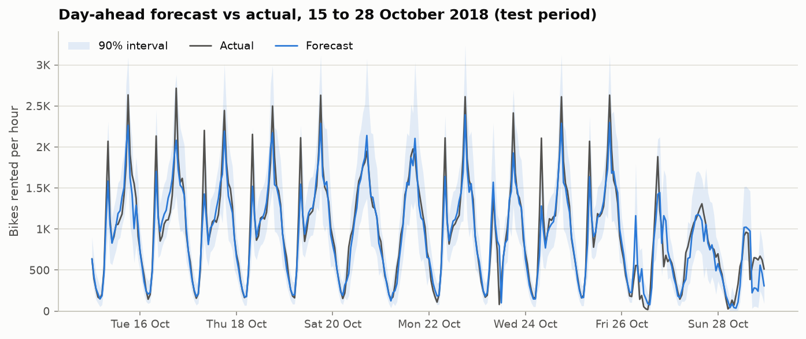
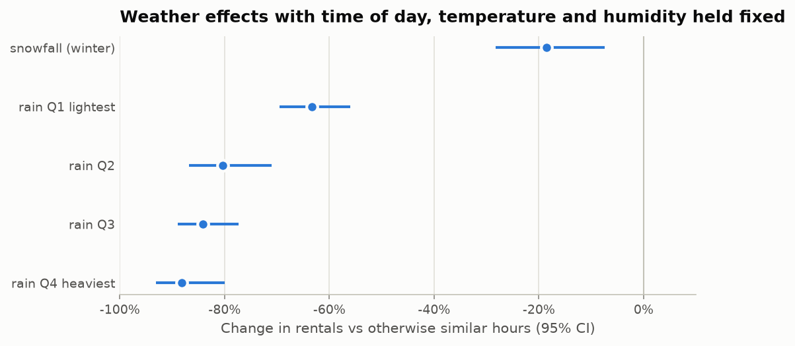
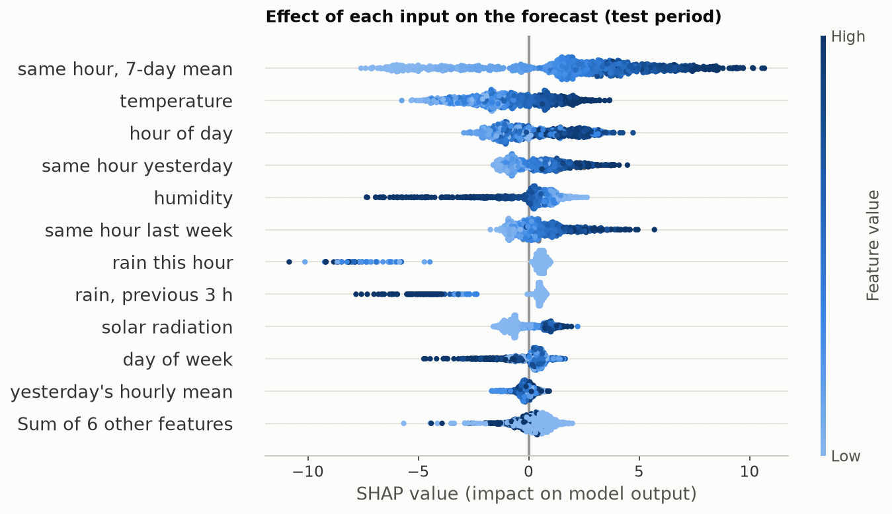

# Seoul bike demand: day-ahead forecast and weather effects

Forecasting tomorrow's hourly bike rentals for Seoul's public bike-sharing system, so bikes can be moved to where they will be needed, and measuring how snow and rain change demand.

**Data:** 8,760 hourly records (1 Dec 2017 to 30 Nov 2018) with weather and calendar fields, from the *Seoul Bike Sharing Demand* dataset in the UCI Machine Learning Repository.

## Results

Tested once on October and November 2018, two months the model never saw during training or tuning:

| Model | Average error (bikes per hour) | R² |
|---|---|---|
| Naive: same hour yesterday | 231 | 0.48 |
| v1 approach (its features, including the date bug) | 253 | 0.60 |
| Ridge regression (v2 features) | 170 | 0.80 |
| **v2: tuned LightGBM** | **139** | **0.86** |

- **40% lower error than the naive baseline and 45% lower than v1.**
- **90% prediction intervals** cover 93% of test hours, with margins calibrated separately for the commuting peaks.



## What affects demand

| Question | Answer |
|---|---|
| Snow (winter) | 35% fewer rentals in raw terms, but about 19 to 25% fewer once temperature, humidity and time of day are held fixed: roughly half of the raw gap is the cold |
| Rain | Drizzle (up to 0.5 mm) cuts demand by about 63%, heavier rain by 80 to 88%, with time of day, season, temperature and humidity held fixed |
| Spring vs summer | In summer about 11% of rides move to different hours, towards the cooler evening (permutation test, p < 0.001) |



These are associations in observational data; the regressions remove the most obvious confounders but cannot prove cause.

## How it works

- **Framing.** Each evening, forecast all 24 hours of the next day. Features may use demand up to that evening, plus the next day's weather.
- **Validation.** Train on Dec 2017 to Sep 2018, test on Oct to Nov 2018. Every model choice and all tuning use expanding-window folds inside the training period (validate on June, July, August, then September), so the test months stay unseen until the end. A unit test checks that no feature uses future demand.
- **Features.** Hour, day of week, holiday, season; weather; rain in the previous 3 hours; demand at the same hour yesterday and last week, the 7-day same-hour mean, and yesterday's hourly mean.
- **Model.** LightGBM on the square root of the count, tuned with Optuna (100 seeded trials with pruning), chosen over tuned XGBoost and a two-model average by cross-validation.
- **Uncertainty.** Split conformal prediction on the square-root scale, calibrated separately for 10 time bands (weekday or weekend/holiday, times five parts of the day).
- **Explainability.** SHAP shows recent same-hour demand setting the level, with temperature, rain and humidity moving it.
- **Statistics.** Welch's t-test, Welch's ANOVA, Kruskal–Wallis and Games–Howell tests; effect sizes; confidence intervals that resample whole days; a day-level permutation test; Poisson regressions with day-clustered standard errors.



## What changed from v1

The original notebooks (in `old/`) reported a test R² of 92%. Measured with v1's own model:

| v1 issue | Effect |
|---|---|
| Dates read month-first (`01/12/17` became 12 Jan 2017) | Wrong month on 35% of rows and wrong weekend flag on 14%. Fixing only this raises R² from 90.6% to 93.0% |
| Random 80:20 split | Forecasting future months instead, R² falls to 70% (square-root scale) and the average error rises from 94 to 240 bikes per hour |
| Optuna scored on the test set | Small here: 92.11% vs 92.05% when tuned by cross-validation |
| Chi-squared test run on proportions | Could never reject (p = 1.0); replaced by a permutation test |
| One-sided hypothesis tested with a two-sided p-value | Fixed |

## Limitations

- Observed weather stands in for weather forecasts. With forecast-like errors in temperature, humidity and wind, the average error rises from 139 to 149 bikes per hour; if rain timing is unknown it can reach 194.
- The weekday 8 am peak is under-forecast, by about 160 bikes per hour on average in the validation months. Like-for-like lag features were tried and did not fix it.
- Holidays and days right after a closure are the hardest days to forecast.
- With one year of data, months and holidays cannot be learned properly.

## Interactive demo

`streamlit run app/streamlit_app.py` opens a page where you pick any day in the test period and see the hourly forecast against what actually happened, with its 90% range. It also shows a SHAP breakdown for any hour and a what-if panel for temperature, humidity and rain.

## Project structure

```
data/SeoulBikeData.csv               raw data
src/bikeshare/                       loading, features, validation, models, intervals, statistics, plotting, serving
notebooks/01_eda.ipynb               data checks and the patterns a forecast must capture
notebooks/02_hypothesis_tests.ipynb  snow, rain and seasonal effects
notebooks/03_forecasting.ipynb       validation, baselines, tuning, test, intervals, SHAP; saves models/
app/streamlit_app.py                 interactive demo
models/                              saved LightGBM model and model card (JSON)
reports/                             figures and test-period predictions
tests/                               pytest suite: date parsing, leakage, splits, statistics, app
old/                                  v1 original notebooks as they were
```

## Run it

```bash
python -m venv .venv && source .venv/bin/activate   # Python 3.11 or newer
pip install -r requirements.txt
pip install -e .
pytest
jupyter nbconvert --to notebook --execute --inplace notebooks/*.ipynb   # about 12 minutes, mostly tuning
streamlit run app/streamlit_app.py
```

Set `N_TRIALS=10` before running the forecasting notebook for a quick pass.
